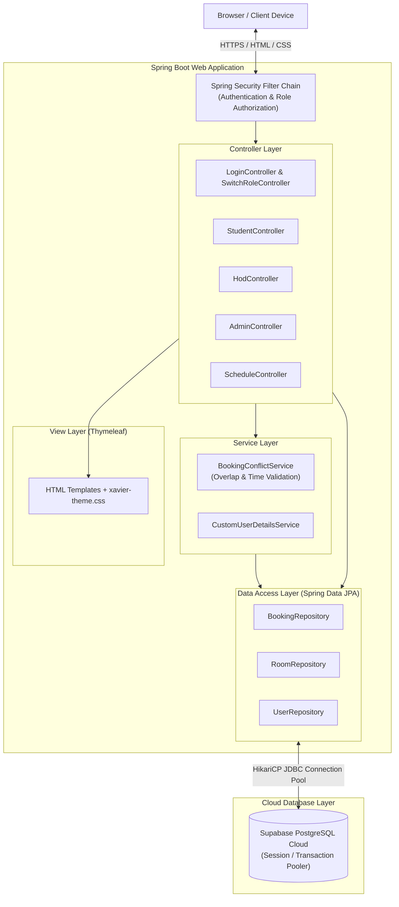
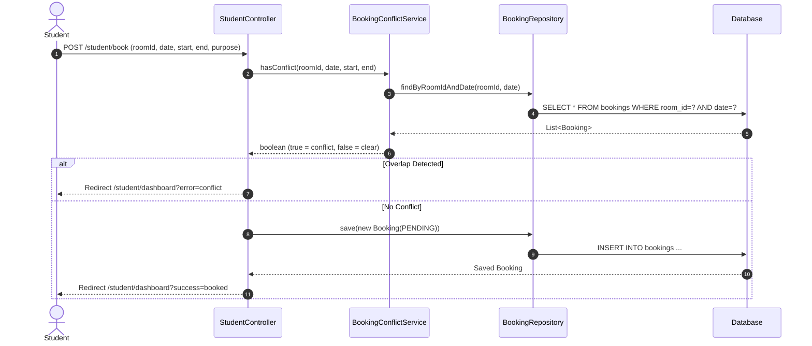

# System Architecture Document

## 1. Architectural Overview

The **St. Xavier's College Room Allocation System** is designed as a modular, monolithic Spring Boot web application utilizing server-side rendering (SSR) via Thymeleaf, backed by Spring Data JPA connected to a managed Supabase PostgreSQL instance.

---

## 2. Key Components & Responsibilities

### 2.1. Presentation Layer (Thymeleaf + CSS)
* **Server-Side Rendered (SSR)**: Generates static HTML on the server before transmitting to the browser, eliminating heavy frontend bundles and providing instant first-paint performance.
* **Layouts & Templates**:
  * `login.html`: Institutional gateway with credentials form and instant role-switch shortcuts.
  * `student-dashboard.html`: Room search filter, booking request form, and user booking history table.
  * `hod-dashboard.html`: Department endorsement queue for student requests.
  * `admin-dashboard.html`: Room management CRUD, final sanction queue, and system analytics counters.
  * `schedule.html`: Visual room-by-room timetable matrix.
* **Theme**: Powered exclusively by [`xavier-theme.css`](file:///Users/ayush/Projects/college%20room%20allocation%20system/room-allocation/src/main/resources/static/css/xavier-theme.css).

### 2.2. Security Layer (Spring Security)
* **Configuration**: Defined in [`SecurityConfig.java`](file:///Users/ayush/Projects/college%20room%20allocation%20system/room-allocation/src/main/java/com/collegeroom/allocationsystem/security/SecurityConfig.java).
* **Role Hierarchy & Route Guards**:
  * `/student/**` $\rightarrow$ Accessible by `STUDENT` and `ADMIN`.
  * `/hod/**` $\rightarrow$ Accessible by `HOD` and `ADMIN`.
  * `/admin/**` $\rightarrow$ Accessible strictly by `ADMIN`.
  * `/login`, `/switch-role`, `/css/**`, `/images/**` $\rightarrow$ Publicly accessible.
* **Post-Login Routing**: [`RoleBasedRedirectHandler`](file:///Users/ayush/Projects/college%20room%20allocation%20system/room-allocation/src/main/java/com/collegeroom/allocationsystem/security/RoleBasedRedirectHandler.java) inspects the authenticated user's granted authorities and routes them immediately to their dedicated portal (`/student/dashboard`, `/hod/dashboard`, or `/admin/dashboard`).
* **Fast-Switch Controller**: [`SwitchRoleController`](file:///Users/ayush/Projects/college%20room%20allocation%20system/room-allocation/src/main/java/com/collegeroom/allocationsystem/controller/SwitchRoleController.java) programmatically creates a Spring Security context in the user's session for rapid testing across roles.

### 2.3. Domain Business Logic & Conflict Detection
* **`BookingConflictService`**:
  * Prevents double allocations by querying the database for all active bookings on a given `(roomId, date)`.
  * Evaluates mathematical interval overlap:
    $$\text{overlap} = (T_{\text{start}} < B.\text{endTime}) \land (T_{\text{end}} > B.\text{startTime})$$
  * Ignores bookings in `REJECTED` status or optional `excludeBookingId` (when updating an existing booking).

### 2.4. Data Access Layer (Spring Data JPA)
* **Entities**:
  * `Room`: Physical venues with attributes `name`, `capacity`, `building`.
  * `User`: System accounts with `name`, `email`, `password` (BCrypt), `role`, `department`.
  * `Booking`: Reservations with `room_id`, `user_id`, `date`, `startTime`, `endTime`, `purpose`, `status`.
* **Repositories**:
  * `RoomRepository`: Queries by name, building, capacity.
  * `UserRepository`: Queries by unique email address.
  * `BookingRepository`: Queries by user, by status, by room and date, or date ranges for the schedule view.

---

## 3. Cloud Database Resilience (HikariCP for Supabase)

Cloud database connections (specifically Supabase's AWS pooler) can disconnect idle TCP connections. To guarantee zero connection dropouts, HikariCP is tuned with active keepalives in `application.properties`:
* `maximum-pool-size=5` (Optimized for Supabase pooler connection limits)
* `minimum-idle=2`
* `idle-timeout=30000` (30 seconds)
* `max-lifetime=90000` (90 seconds to prevent stale cloud sockets)
* `connection-timeout=10000` (10 second connect threshold)
* `keepalive-time=30000` (Periodic ping keeps cloud socket alive)
* `connection-test-query=SELECT 1`
