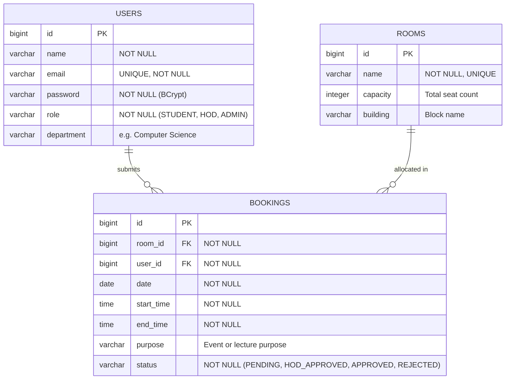

# Database Documentation & Supabase Setup

This document specifies the database architecture, schema definitions, connection pooling parameters, and step-by-step instructions for connecting your personal **Supabase PostgreSQL** cloud database.

---

## 1. Setting Up Your Own Personal Supabase Database

Follow these steps to deploy and manage the database under your personal Supabase account:

### Step 1: Create a Free Supabase Project
1. Log in to [Supabase](https://supabase.com).
2. Click **New Project**.
3. Enter a project name (e.g., `xavier-room-allocation`) and set a strong database password (e.g. `MySecurePass123!`).
4. Select your preferred AWS region (e.g., `ap-south-1` Mumbai or `ap-southeast-1` Singapore for lowest latency from India).
5. Click **Create new project**.

### Step 2: Retrieve Your JDBC Connection String
1. In your Supabase dashboard, navigate to **Project Settings** (gear icon) $\rightarrow$ **Database**.
2. Scroll to the **Connection string** section and select the **URI** or **JDBC** tab.
3. Choose **Connection pooling** (recommended mode: *Transaction* or *Session* on port `6543` or `5432`):
   ```text
   jdbc:postgresql://<host>.pooler.supabase.com:5432/postgres?sslmode=require
   ```
   *Note: If using Transaction pooler (port 6543), username format is usually `postgres.<project-ref>`.*
4. Prepare your credentials:
   * **URL**: `jdbc:postgresql://<host>.pooler.supabase.com:5432/postgres?sslmode=require&connectTimeout=10&socketTimeout=30&tcpKeepAlive=true`
   * **Username**: `postgres.<project-ref>` (or `postgres` if direct connection)
   * **Password**: The database password you chose in Step 1.

### Step 3: Configure Environment Variables
Copy `.env.example` to `.env` in the `room-allocation` root directory and set your values:
```bash
cp .env.example .env
```
Fill in `.env`:
```properties
DB_URL=jdbc:postgresql://<your-supabase-host>:5432/postgres?sslmode=require&connectTimeout=10&socketTimeout=30&tcpKeepAlive=true
DB_USERNAME=postgres.<your-project-ref>
DB_PASSWORD=<your-database-password>
PORT=8081
```

---

## 2. Entity-Relationship Diagram (ERD)



---

## 3. Data Dictionary

### Table: `users`
| Column | Type | Constraints | Description |
|---|---|---|---|
| `id` | `BIGINT` | `PRIMARY KEY GENERATED ALWAYS AS IDENTITY` | Unique user identifier |
| `name` | `VARCHAR(255)` | `NOT NULL` | Full display name |
| `email` | `VARCHAR(255)` | `NOT NULL UNIQUE` | Official college or test email |
| `password` | `VARCHAR(255)` | `NOT NULL` | BCrypt-hashed password string |
| `role` | `VARCHAR(50)` | `NOT NULL` | Enum: `STUDENT`, `HOD`, `ADMIN` |
| `department` | `VARCHAR(255)` | `NULLABLE` | Academic department (e.g. `Computer Science`) |

### Table: `rooms`
| Column | Type | Constraints | Description |
|---|---|---|---|
| `id` | `BIGINT` | `PRIMARY KEY GENERATED ALWAYS AS IDENTITY` | Unique room identifier |
| `name` | `VARCHAR(100)` | `NOT NULL UNIQUE` | Institutional room label (e.g., `Lrs 1`, `Crs 15`, `MMR`) |
| `capacity` | `INTEGER` | `NOT NULL DEFAULT 50` | Maximum seating capacity |
| `building` | `VARCHAR(100)` | `NOT NULL` | Physical building / block (e.g., `Lrs Block`, `Main Block`) |

### Table: `bookings`
| Column | Type | Constraints | Description |
|---|---|---|---|
| `id` | `BIGINT` | `PRIMARY KEY GENERATED ALWAYS AS IDENTITY` | Unique booking ID |
| `room_id` | `BIGINT` | `NOT NULL REFERENCES rooms(id) ON DELETE CASCADE` | Associated venue |
| `user_id` | `BIGINT` | `NOT NULL REFERENCES users(id) ON DELETE CASCADE` | Requisitioning user |
| `date` | `DATE` | `NOT NULL` | Allocation date |
| `start_time` | `TIME` | `NOT NULL` | Reservation start time |
| `end_time` | `TIME` | `NOT NULL` | Reservation end time |
| `purpose` | `TEXT` | `NULLABLE` | Description of event / activity |
| `status` | `VARCHAR(50)` | `NOT NULL DEFAULT 'PENDING'` | State: `PENDING`, `HOD_APPROVED`, `APPROVED`, `REJECTED` |

---

## 4. Database Indexes for High-Traffic Performance

To guarantee sub-millisecond conflict checks and calendar schedule lookups:
```sql
CREATE INDEX idx_bookings_room_date ON bookings(room_id, date);
CREATE INDEX idx_bookings_status ON bookings(status);
CREATE INDEX idx_bookings_user_id ON bookings(user_id);
CREATE INDEX idx_users_email ON users(email);
CREATE INDEX idx_rooms_name ON rooms(name);
```

---

## 5. Automatic DDL vs. Manual Migration

* **Hibernate Auto-DDL**: `spring.jpa.hibernate.ddl-auto=update` is configured in `application.properties`. When the application connects to your Supabase instance, Hibernate will automatically create all missing tables, columns, foreign keys, and sequences without requiring manual SQL commands.
* **Manual SQL Scripts**: If you prefer executing raw DDL directly in the Supabase SQL Editor, pre-built scripts are provided in:
  * `supabase/schema.sql` $\rightarrow$ Complete table & index definitions.
  * `supabase/seed.sql` $\rightarrow$ Complete room catalog and default test users.
