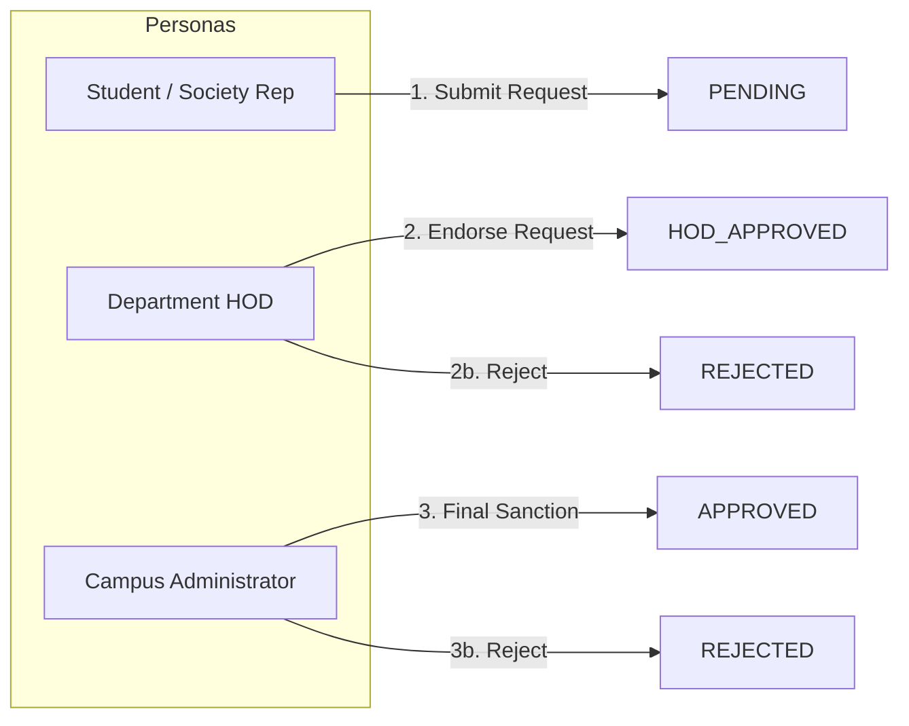

# Product Requirements Document (PRD)

## 1. Executive Summary & Objective

The **St. Xavier's College Room Allocation System** is a centralized web platform engineered to eliminate scheduling friction, double bookings, and paper-based paperwork across St. Xavier's College (Autonomous), Mumbai. It digitizes the end-to-end room requisition and venue allocation workflow across academic departments, student societies, and campus infrastructure administration.

---

## 2. User Personas & Permissions



### 2.1. Student (`ROLE_STUDENT`)
* **Objective**: Search for available rooms, book spaces for co-curricular/society events, and track requisition status.
* **Capabilities**:
  * Browse and search all campus rooms by building, type, and capacity.
  * Submit booking requests with date, start time, end time, and event purpose.
  * View personal booking history with real-time status badges (`PENDING`, `HOD_APPROVED`, `APPROVED`, `REJECTED`).
  * Cancel requests that are still pending.

### 2.2. Head of Department (`ROLE_HOD`)
* **Objective**: Review student requests originating from their academic department to ensure academic compliance and propriety before escalation to campus facilities.
* **Capabilities**:
  * View pending departmental requests awaiting endorsement.
  * Review booking details (student name, room, timeslot, purpose).
  * Approve request (transitions state to `HOD_APPROVED`).
  * Reject request (transitions state to `REJECTED`).

### 2.3. Administrator (`ROLE_ADMIN`)
* **Objective**: Central campus management, room inventory oversight, and final venue allotment.
* **Capabilities**:
  * View all requests endorsed by HODs (`HOD_APPROVED`) and grant final approval (`APPROVED`) or rejection.
  * Full room management: Add new rooms, adjust capacity, configure building assignments, or decommission rooms.
  * Interactive Campus Schedule: View real-time room occupancy grid across dates and slots.
  * Administer user roles and oversee campus-wide booking analytics.

---

## 3. Room Inventory Specifications

St. Xavier's College features diverse academic and cultural facilities categorized into structured blocks:

1. **Lecture Rooms (Lrs 1 to 50)**:
   * Standard institutional classrooms located in the Lrs Block.
   * Fixed seating capacity: 70 seats each.
   * Suitable for lectures, club meetings, and department symposiums.
2. **Classrooms (Crs 1 to 40)**:
   * Academic seminar classrooms in the Crs Block.
   * Seating capacity: 50 seats each.
3. **Specialized Venues & Halls**:
   * **Seminar Room**: Main Block, 80 capacity.
   * **Multi-Media Room (MMR)**: Main Block, 90 capacity, equipped with state-of-the-art audiovisual systems.
   * **SCAVI (St. Xavier's Audio Visual Institute)**: Main Block, 60 capacity, tiered screening theater.
   * **Bonet Lab**: Science Block, 80 capacity, specialized lab facility.
   * **Knowledge Lab**: Library Block, 30 capacity, high-tech computing and research facility.

---

## 4. Functional Requirements

### FR-1: Conflict-Free Scheduling Engine
* **Rule**: Two bookings cannot occupy the same room on the same date with overlapping time windows.
* **Overlap Condition**: A new booking $(S_{\text{new}}, E_{\text{new}})$ overlaps with an existing booking $(S_{\text{existing}}, E_{\text{existing}})$ if and only if:
  $$S_{\text{new}} < E_{\text{existing}} \quad \text{and} \quad E_{\text{new}} > S_{\text{existing}}$$
* Bookings with status `PENDING`, `HOD_APPROVED`, or `APPROVED` block the room from conflicting reservations. Bookings with status `REJECTED` release the slot immediately.

### FR-2: Two-Stage Approval State Machine
```text
[Draft] -> (Submit) -> [PENDING] 
                          |
             +------------+------------+
             |                         |
     (HOD Endorses)              (HOD Rejects)
             |                         |
             v                         v
      [HOD_APPROVED]              [REJECTED]
             |
     +-------+-------+
     |               |
(Admin Confirms) (Admin Rejects)
     |               |
     v               v
 [APPROVED]      [REJECTED]
```

### FR-3: Institutional Real-Time Schedule Grid
* Cross-sectional tabular timeline allowing students and staff to view room occupancy across any selected date.
* Visual color coding distinguishing booked periods from vacant time slots.

### FR-4: Fast Role Switching for Development
* A dedicated convenience controller `/switch-role?role={ROLE}` allows instant evaluation of Student, HOD, and Admin dashboards without requiring manual logout and credential re-entry during reviews and demos.

---

## 5. Non-Functional Requirements

| Requirement | Standard |
|---|---|
| **Performance** | Page render response time $< 200\text{ ms}$ under local load; DB pool latency $< 100\text{ ms}$ to Supabase. |
| **Availability & Uptime** | HikariCP pool optimization to survive Supabase idle disconnects without socket drops. |
| **Security** | BCrypt password hashing for all user credentials; Spring Security authorization filters on all endpoints. |
| **Aesthetic Consistency** | Strict adherence to the St. Xavier's College Jesuit heritage aesthetic (maroon, cream, gold). |
| **Device Responsiveness** | Fully responsive layout supporting mobile screens ($\ge 375\text{px}$) and desktop monitors ($\ge 1200\text{px}$). |
